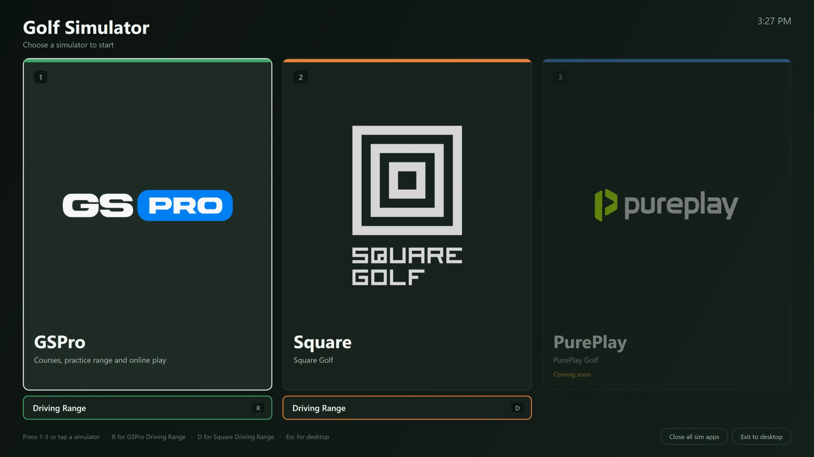

# Golf Simulator Launcher

A full-screen, touch-friendly menu for Windows golf simulator PCs. Pick a simulator — or jump straight to its driving range — and the launcher closes whatever was running, starts the supporting apps (OBS, launch-monitor bridges, stream deck servers…), and clicks through the simulator's launch screens for you.

Everything is driven by a single JSON file, so adding a new simulator or changing the boot sequence doesn't require touching any code.



## Features

- **One-tap boot** — big tiles for each simulator, plus optional shortcut buttons (e.g. *Driving Range*) underneath.
- **Clicks through launcher screens** — presses buttons in normal Windows apps via UI Automation, and in game engines (Unity, Unreal) by reading the screen with Windows' built-in OCR.
- **Clean switching** — closes leftover sim apps (gracefully first, then whole process trees) before every boot, and asks for admin rights once if something was started elevated.
- **Live progress** — every step is shown with a ✓ / – / ✕ as it runs; failures say what went wrong and let you go back to the menu.
- **Stays out of the way** — minimizes to the taskbar when the sim is ready; launching it again brings the existing window back instead of opening a second copy.
- **Starts at login, quickly** — one install script adds it to Startup and the Desktop. When it runs from Startup it turns off Windows' startup-app delay for that account (from the next sign-in; `install.ps1 -Uninstall` restores it), and its native helper is compiled once and cached in `%LOCALAPPDATA%\GolfSimLauncher`.
- **Keyboard support** — `1`–`9` pick a simulator, letter keys trigger shortcut buttons, `Esc` exits.
- **No dependencies** — plain PowerShell 5.1 + WPF, which ship with Windows 10 and 11.

### Included recipes

The sample `launcher.example.json` is a working setup for:

| Simulator | Boot | Shortcut |
|---|---|---|
| **GSPro** | OBS → GSPro launcher → opens GSPconnect's *Visual Data* (Square launch monitor connector) → brings GSPro to the front | **Driving Range (R)** — clicks *Launch GSPro*, *Practice*, *GSPro Practice* |
| **Square Golf** | OBS → Square launcher → *Update* if available, otherwise *Play* → *Sign in* → *Skip* device search | **Driving Range (D)** — clicks *Driving Ranges*, then *Play* |
| **PurePlay** | Placeholder (disabled) | — |

## Requirements

- Windows 10 or 11
- Windows PowerShell 5.1 (built in — PowerShell 7 is not required)
- An English (or other OCR-supported) language pack for the screen-reading steps — installed by default on English Windows
- A 4K display is not required, but the sample recipes were tuned on one

## Quick start

1. **Download** this repository (or `git clone` it) somewhere permanent, e.g. `C:\GolfLauncher`.
2. **Create your config** — copy `launcher.example.json` to `launcher.json` (the launcher also does this for you on first run) and adjust it to your setup: app paths, your OBS scene collection (`--collection "Name"` in the OBS `args`), and any extra apps to start or close (see [Configuration](#configuration)). Paths can use environment variables like `%LOCALAPPDATA%`, and relative paths are relative to the launcher folder. `launcher.json` is git-ignored, so pulling updates never overwrites your setup.
3. **Try it** without starting anything:

   ```powershell
   powershell -NoProfile -STA -ExecutionPolicy Bypass -File launcher.ps1 -Windowed -DryRun
   ```

4. **Install** it to start at login and add a Desktop shortcut:

   ```powershell
   powershell -ExecutionPolicy Bypass -File install.ps1
   ```

   Run this while signed in as the Windows account that uses the simulator — apps such as OBS and Square keep their settings per account. To install for a different account from an admin account, add `-User <name>`. Remove it again with `-Uninstall`.

### Command-line options

| Option | What it does |
|---|---|
| `-Config <path>` | Use a different config file (default: `launcher.json` next to the script) |
| `-Select gspro` | Boot a simulator immediately, skipping the menu |
| `-Select gspro:range` | Boot a simulator's shortcut action immediately |
| `-Windowed` | Open in a normal window instead of full screen |
| `-DryRun` | Walk through the steps without starting, closing or clicking anything |

## Configuration

`launcher.json` has five parts:

```jsonc
{
    // Window
    "title": "Golf Simulator",
    "subtitle": "Choose a simulator to start",
    "icon": "C:\\path\\to\\icon.ico",
    "fullscreen": true,
    "whenReady": "minimize",     // "minimize" (default), "stay" or "close"
    "autoBootSeconds": 0,        // > 0 starts defaultSim after a countdown
    "defaultSim": "gspro",

    "beforeEachSim": [ ... ],    // steps run before every boot
    "stepSets":      { ... },    // named, reusable lists of steps
    "sims":          [ ... ],    // the tiles on the menu
    "closeAll":      [ ... ]     // steps for the "Close all sim apps" button
}
```

### Simulators

```jsonc
{
    "id": "square",                       // used by -Select
    "name": "Square",
    "subtitle": "Square Golf",
    "accent": "#E8833A",                  // tile colour
    "image": "logos\\square.png",         // optional tile artwork (PNG/JPG; relative paths are
                                          // relative to the launcher folder; SVG isn't supported)
    "check": "%LOCALAPPDATA%\\Programs\\Square Golf Launcher\\Square Golf Launcher.exe",
                                          // tile shows "Not installed" if this file is missing
    "enabled": true,                      // false greys the tile out…
    "status": "Coming soon",              // …with this text
    "steps": [ { "type": "include", "set": "squareBoot" } ],
    "actions": [                          // optional buttons under the tile
        {
            "id": "range", "label": "Driving Range", "key": "D",
            "steps": [ ... ]              // replaces the sim's own steps
        }
    ]
}
```

Action keys are global, so give each action a different letter.

### Steps

Every step has a `type`, and optionally:

- `label` — the text shown while it runs
- `optional: true` — a failure is shown as skipped instead of stopping the boot
- `timeout` — seconds to wait (default 60)

| Type | Does | Options |
|---|---|---|
| `include` | Runs a named list from `stepSets` (can be nested) | `set` |
| `start` | Starts a program | `path`, `args`, `workingDir`, `wait` (wait for it to exit), `minimized`, `skipIfRunning`, `conhost` (open a console app in the classic console instead of Windows Terminal, so the taskbar shows the app's own icon) |
| `kill` | Closes programs by process name, including their child processes, and checks none are left | `names`, `graceful` (ask them to close first; `timeout` is how long to wait) |
| `killCommandLine` | Closes processes whose command line matches a wildcard pattern (e.g. a Chrome app window) | `pattern` |
| `waitProcess` | Waits for a process to appear | `name` |
| `waitPort` | Waits for something to listen on a local TCP port | `port` |
| `delay` | Waits | `seconds` |
| `deleteFiles` | Deletes files matching a wildcard path | `path` |
| `focus` | Brings a program's window to the front | `process`, `settle` (seconds to wait first) |
| `clickButton` | Presses a button found through Windows UI Automation — works for most normal desktop apps (WinForms, WPF, Qt, Electron) | see below |
| `clickText` | Finds text on a program's window with OCR and clicks it — for games and custom-drawn UIs | see below |

**`clickButton` options**

| Option | Meaning |
|---|---|
| `process` | Process name without `.exe` |
| `text` | The button's name (usually its caption) |
| `clickFirst` | Another button to press first whenever it's enabled — e.g. `"UPDATE"` before `"PLAY"` |
| `doneIfProcess` | Skip if this process is already running (the app moved on by itself) |
| `doneIfWindowClass` | Skip once `process` shows a window of this class (e.g. `UnityWndClass`) |
| `doneIfPort` | Skip once something listens on this port |
| `ifCommandLine` | Only press if `process` was started with a matching command line |
| `settle` | With `clickFirst`: seconds to wait before trusting that it isn't needed (default 2) |

**`clickText` options**

| Option | Meaning |
|---|---|
| `process` | Process name without `.exe` |
| `text` | Words to find. A line that is exactly this text (a button) wins over a sentence that contains it |
| `settle` | Seconds to wait after the text first appears, so menus finish animating (default 0.6) |
| `confirmGone` | Look again after clicking and click again (up to 6 times) while the text is still there. Only use it when the next screen doesn't show the same text |
| `parkMouse` | Move the pointer to the window's corner afterwards |

### Finding button names

For `clickButton`, list what UI Automation can see in a running app:

```powershell
Add-Type -AssemblyName UIAutomationClient, UIAutomationTypes
$ae = [System.Windows.Automation.AutomationElement]
$id = (Get-Process 'Square Golf Launcher').Id
$cond = New-Object System.Windows.Automation.PropertyCondition($ae::ProcessIdProperty, $id)
$ae::RootElement.FindAll('Children', $cond) | ForEach-Object {
    $_.FindAll('Descendants', [System.Windows.Automation.Condition]::TrueCondition) |
        Where-Object { $_.Current.Name } |
        ForEach-Object { '{0,-12} {1}' -f $_.Current.ControlType.ProgrammaticName.Split('.')[1], $_.Current.Name }
}
```

If nothing useful shows up (typical for Unity and Unreal games), use `clickText` with the words printed on the button.

## Troubleshooting

- **Logs** — every boot is written to `launcher.log` next to the script, including where each click landed.
- **A `clickText` step never finds its text** — the target window must be visible and in front; the launcher minimizes itself while it reads the screen. Check the spelling against what's actually shown, and that a supported OCR language is installed (`Get-WindowsCapability -Online -Name Language.OCR*`).
- **A click lands but nothing happens** — some games show buttons before they accept input. Increase `settle` or add `confirmGone: true`.
- **"…is running as administrator and couldn't be closed"** — something was started elevated. Accept the UAC prompt, or close it yourself. Avoid starting sim apps "as administrator".
- **OBS asks about Safe Mode** — add the `deleteFiles` step for `%APPDATA%\obs-studio\.sentinel\run_*` before starting OBS (the sample config does), and the `Run in Normal Mode` fallback click.
- **Wrong OBS scenes or no websocket** — OBS settings are per Windows account; make sure the account running the launcher has the scene collection and has *Tools → WebSocket Server Settings → Enable* turned on.
- **Clicks land in the wrong place on high-DPI screens** — the launcher is DPI-aware; if you run pieces of it from another script, call `SetProcessDPIAware` first.

## Contributing

Contributions are welcome — especially recipes for more simulators and launch monitors.

- **New simulator recipes**: add a `sims` entry (and any `stepSets`) to `launcher.example.json` — not your own `launcher.json`, which isn't tracked — using `%LOCALAPPDATA%`/`%ProgramFiles%` style paths rather than your own user folder. Mention the simulator version you tested in your pull request.
- **New step types**: add a case to `Invoke-Step` in `launcher.ps1`, keep it working under `-DryRun`, log anything useful with `Write-Log`, and document it in the table above.
- **Keep it dependency-free**: the launcher must run on a fresh Windows install with Windows PowerShell 5.1 — no modules, no PowerShell 7-only syntax.
- **Test** with `-Windowed -DryRun` for layout and flow, then with a real boot.
- **Bugs**: open an issue with the relevant part of `launcher.log`, your Windows version, screen resolution, and a screenshot of the screen it got stuck on.

## Project layout

```
launcher.ps1            the app (UI, step runner, automation helpers)
launcher.example.json   sample config with the GSPro / Square / PurePlay recipes
launcher.json           your own config (git-ignored; created from the example on first run)
install.ps1             adds/removes the Startup and Desktop shortcuts
*.png                   tile logos
docs/                   README images
launcher.log            created at runtime (git-ignored)
```

## Disclaimer

This project isn't affiliated with GSPro, Square Golf, PurePlay, OBS, or any other product it launches. It only automates clicks on your own machine; it never stores or enters passwords — sign-ins rely on the simulator's own "remember me".

## License

Released under the [MIT License](LICENSE). The software is provided "as is", without warranty of any kind, and the authors aren't liable for any damage or problems arising from its use. It closes programs and clicks on your screen, so try it with `-DryRun` first and use it at your own risk.
